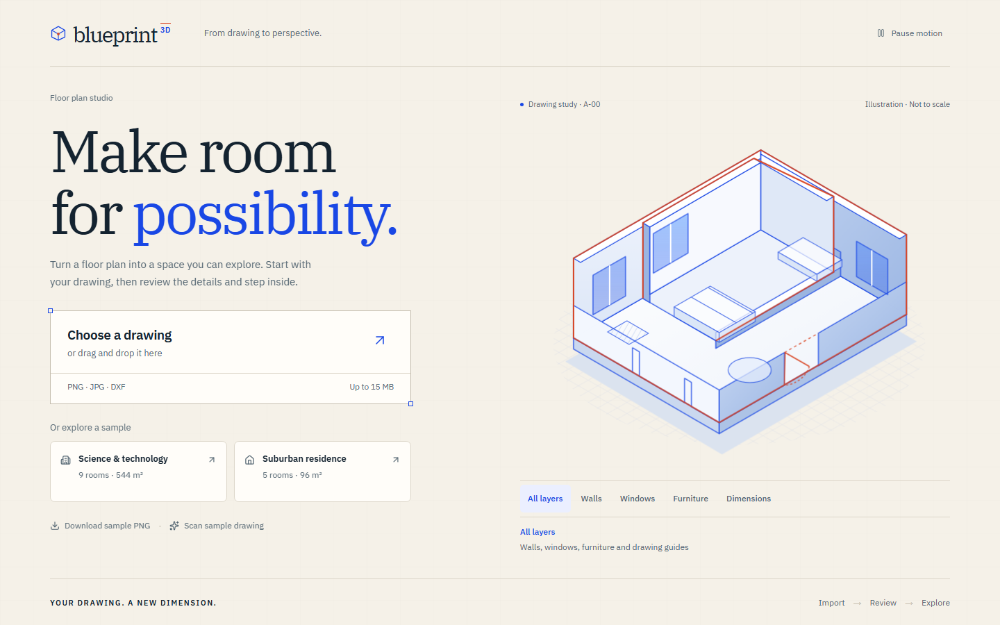
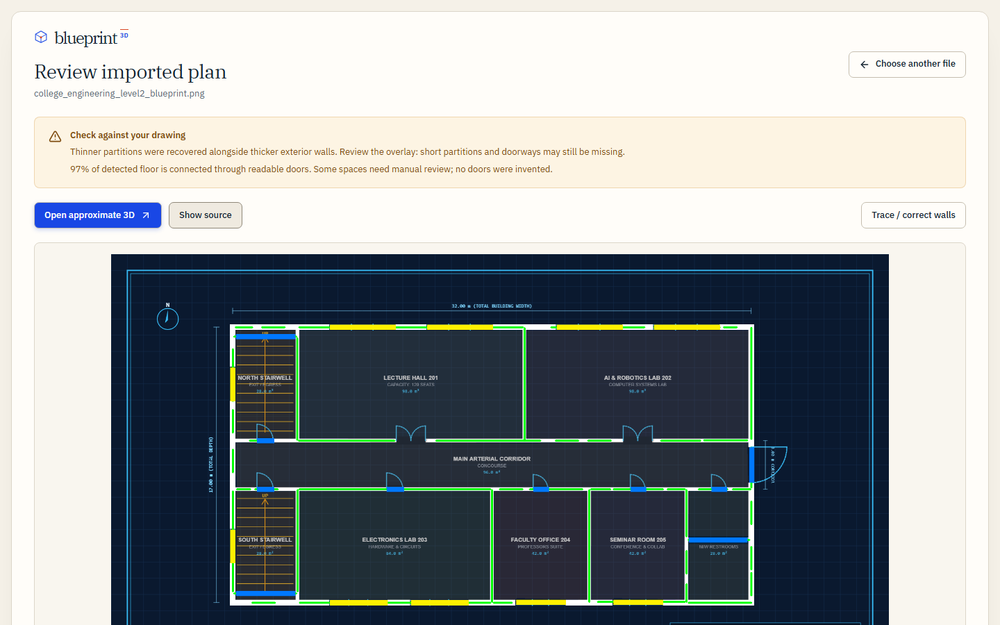
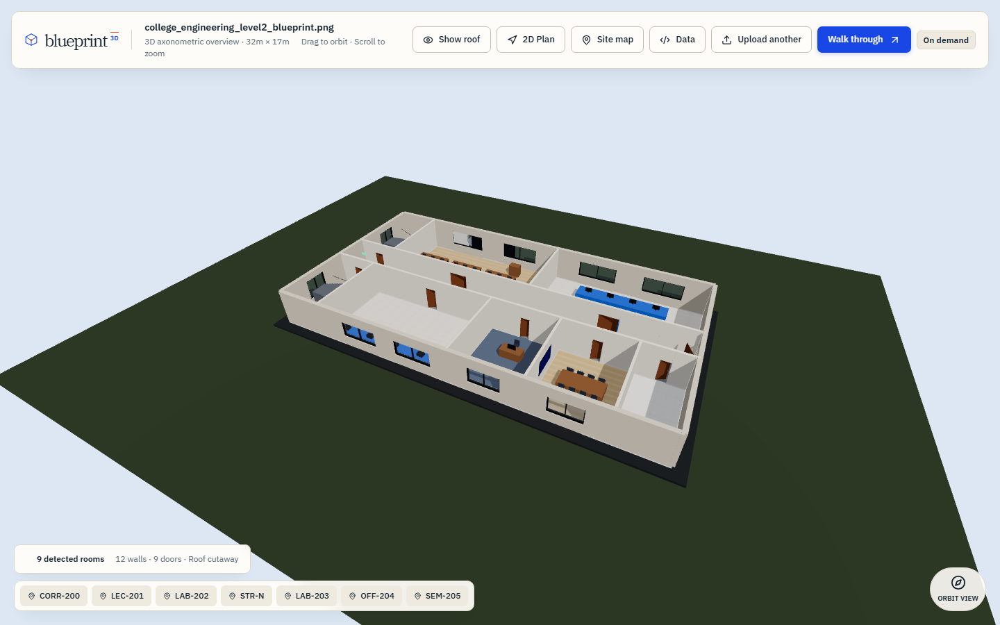
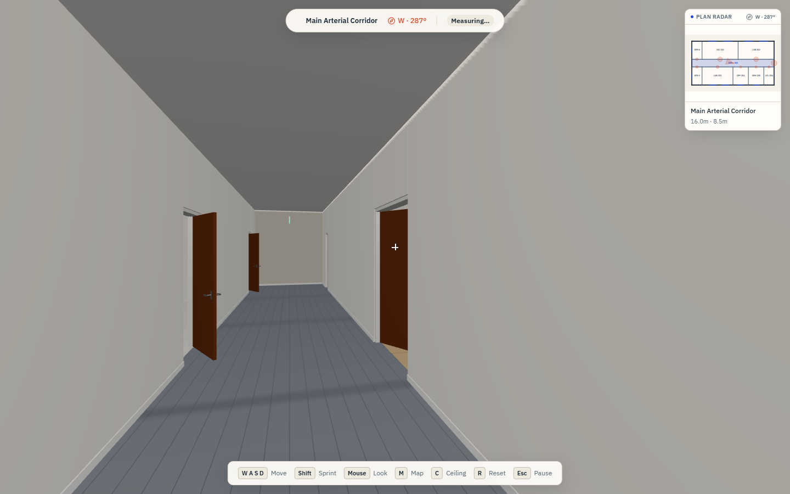
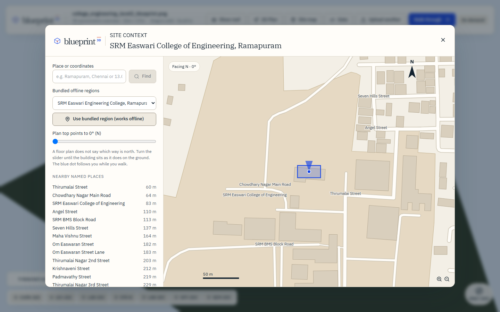

# Blueprint3D — 2D Floor Plan to Walkable 3D


A floor plan is just lines on paper. Most people cannot turn it into a picture of the real
space: how the rooms connect, how wide the corridor is, where the light comes in.

Blueprint3D takes a PNG, JPG or DXF of a floor plan, detects the walls, doors, windows and
rooms, builds a 3D model, and lets you walk through it first-person in the browser. No CAD
licence, no modelling software, nobody tracing walls by hand.

**Live demo:** [blueprint3d-eta.vercel.app](https://blueprint3d-eta.vercel.app)
(the backend sleeps when idle, so the first upload after a quiet period can take 30–60 s)



## What it does

| Step | What you see | Screenshot |
|---|---|---|
| **1. Import** | Upload a PNG, JPG or DXF (up to 15 MB), or open a bundled sample. |  |
| **2. Review** | If the drawing is not a clean filled-wall plan, the app shows what it detected (walls green, doors blue, windows yellow) and warns about anything uncertain. You can trace walls by hand to correct it. |  |
| **3. Overview** | An orbitable 3D model with doors, windows, furniture, labelled rooms and a roof you can toggle. |  |
| **4. Walk** | First-person movement with collision, a plan radar, a compass and room names. |  |
| **5. Site map** | The building placed on a map of its surroundings. It works offline for bundled regions. |  |

Screenshots were taken from the running app on 2026-11-04.

## How it works: a three-lane pipeline

The project is split into three lanes. Each lane has a fixed input and output format, so
each person can build and test their part without waiting on the others.

```
floor plan image / DXF
        |   Lane 1 · Python (OpenCV, ezdxf)       Benicia
        v
 detected walls, doors, windows, rooms
        |   Lane 2 · geometry                      Aakash
        v
 3D level data (walls, openings, spawn point)
        |   Lane 3 · Three.js                      Anupriya
        v
 walkable 3D scene in the browser
```

| Lane | Owner | Job | Where |
|---|---|---|---|
| **1. Detect** | Benicia | Separate walls from symbols, labels and furniture. Detect doors and windows, estimate scale, read DXF geometry. | `blueprint3d-app/backend/` |
| **2. Model** | Aakash | Turn the detected layout into extruded wall, door and window geometry. | `blueprint3d-app/src/scene/`, and the original Java stage in `src/main/java/` |
| **3. Explore** | Anupriya | Render the scene, handle first-person movement, collision, doors, minimap and site map. | `blueprint3d-app/src/navigation/`, `src/ui/` |

### Lane 1: detection (Python, `blueprint3d-app/backend/`)

| File | Role |
|---|---|
| `blueprint_import.py` | Decides whether a file opens directly, opens for review, or opens as an editable reference. |
| `structural_evidence.py` | Finds filled walls, adapts to image resolution, flags uncertain connectivity. |
| `linework.py` | Recovers paired-outline walls (two thin lines drawn as one wall). |
| `wall_detector.py` | Wall detection with OpenCV. |
| `shell_geometry.py` | Builds connected wall footprints, with holes for rooms. |
| `dxf_import.py` | Reads DXF with `ezdxf`, including nested block transforms. Ducts, leaders, tables and annotation layers are excluded. |
| `geo.py`, `fetch_region.py` | Site map lookup and offline region bundling. |
| `main.py` | FastAPI app. |

The central idea is that **walls are drawn thick and everything else is drawn thin**. Door
swing arcs, furniture, labels and dimension lines are all thin strokes. That one difference
is what separates a real wall from the symbols drawn on top of it.

### Lane 2: geometry

Connected wall footprints (with room holes) are extruded in height slices at door and window
heights, instead of stitching together fragmented Hough lines. Floors and roofs keep the
footprint shape, and openings keep their detected proportions. Collision uses the same
ground-level wall geometry, so what you see is what stops you.

The first prototype did this step in Java (`src/main/java/com/blueprint/`), which turned a
text grid into merged wall boxes, door lintels and window panes. That version is still in the
repo. See [Legacy prototype](#legacy-prototype-python--java--threejs).

### Lane 3: exploration (React + Three.js, `blueprint3d-app/src/`)

| Path | Role |
|---|---|
| `navigation/FirstPersonController.ts` | Pointer-lock look, WASD movement, sprint, damped camera. |
| `navigation/CollisionSystem.ts` | Collision against the wall footprint. |
| `scene/` | Wall, door, window and floor generation, static mesh batching. |
| `ui/` | Start screen, import review, minimap, site map, data inspector. |
| `utils/geoMap.ts` | Plan-to-map rotation, compass heading, per-plan map state in `localStorage`. |

## Run it

You need Python 3.10+ and Node.js (tested on Node 24 and Python 3.14).

```bash
cd blueprint3d-app
py -m pip install -r backend/requirements.txt
npm ci
npm run dev
```

Open <http://localhost:3000>. Vite serves the frontend and proxies `/api` to FastAPI on
`127.0.0.1:8001`.

**Controls while walking:** `W A S D` move, `Shift` sprint, mouse to look, `M` map, `C`
ceiling, `R` reset, `Esc` pause. Walking needs pointer lock, which some embedded browser
panels block. Use a normal browser tab.

### Tests

```bash
cd blueprint3d-app
py -m unittest discover -s backend -p "test_*.py" -v   # 40 backend tests
npm run lint                                           # TypeScript type check
npm run build
```

The backend tests cover clean and gray-wall plans, small images, outlined plans, invalid and
blank files, nested DXF blocks, door and opening evidence, and a 46-variant synthetic suite
(rotation, mirroring, inversion, JPEG, noise, blur, skew, paired outlines). The Three.js
checks cover geometry bounds, spawn and door clearance, manual tracing, map rotation, compass
heading and storage. They are in `tests/geometry-regression.ts` and `tests/geo-regression.ts`
(run commands are in [blueprint3d-app/README.md](blueprint3d-app/README.md)).

## Site map

The **Site map** button shows roads, buildings, water, green areas and named places within
300 m of the building, with the plan outline and your position while you walk.

- Data is OpenStreetMap (ODbL), fetched once per place through Nominatim and Overpass. Each
  result is cached on the server and in the browser, so a map you have opened works offline.
- The sample campus (SRM Easwari College, Ramapuram) is bundled and needs no network.
- A floor plan does not say which way is north, so there is a rotation slider.
- Add your own offline region with
  `py backend/fetch_region.py "Your place name"`.
- It is a vector map, not satellite imagery.

## Honest limits

- The importer is heuristic. It is not guaranteed to reconstruct every blueprint style.
- Of the 16 supplied test files, 6 opened as direct models, 7 as approximate models with a
  review step, and 3 as editable references. That confirms import coverage, not architectural
  accuracy.
- Scanned, outlined or furniture-heavy drawings can come out with extra or missing walls and
  openings. Fix them with the trace tool.
- Scale assumes typical door widths unless you enter the real footprint width.
- Room labels from OCR and automatic DXF-to-building reconstruction are not implemented.
- Uploaded plans do not get invented furniture, stairs or room labels.
- The tactical-planning extension (entry and exit markers, safe and danger zones) is planned,
  not built.

## Deployment

Pushing to `main` redeploys both halves.

| Part | Host | URL |
|---|---|---|
| Frontend (Vite) | Vercel project `blueprint3d`, root `blueprint3d-app` | <https://blueprint3d-eta.vercel.app> |
| Backend (FastAPI) | Render web service `blueprint3d-api` (free plan) | <https://blueprint3d-api.onrender.com> |

Render's free plan has an ephemeral filesystem, so server-side cached maps do not survive a
restart. Bundled regions and browser `localStorage` cover the offline demo. To allow a new
frontend URL, add it to `ALLOWED_ORIGINS` on Render. Do not add a `vercel.json` with
`services`, because Vercel's 4.5 MB request limit would reject larger plan uploads.

## Repository layout

| Path | What's there |
|---|---|
| `blueprint3d-app/` | **Current prototype**: React + Three.js frontend, FastAPI backend |
| `blueprint3d-app/backend/` | Lane 1 detection, DXF import, site map API, tests |
| `blueprint3d-app/src/` | Scene generation, navigation, UI |
| `blueprint3d-app/public/geo/` | Bundled offline map regions |
| `docs/images/` | Screenshots used in this README |
| `server.py`, `tools/`, `web/`, `blueprints/` | Legacy Flask prototype |
| `src/main/java/com/blueprint/`, `pom.xml` | Legacy Java grid-to-geometry stage |
| `ARCHITECTURE.md` | Deep dive into the legacy prototype |
| `TEAM_SPLIT.md` | How the three lanes were divided to stay independent |

## Legacy prototype (Python + Java + Three.js)

The first version ran as a three-language pipeline: Python turned the image into a text grid
(`1` wall, `0` floor, `3` doorway, `4` window), Java turned the grid into level JSON, and a
plain Three.js page rendered it. It is kept for reference and still runs:

```bash
py -m pip install -r requirements.txt
py server.py        # needs JDK 17 and Maven on PATH, then open http://localhost:8000
```

See [ARCHITECTURE.md](ARCHITECTURE.md) for why stroke thickness separates walls from door
arcs, how room segmentation handles open plans, and the bugs behind many of the guard
clauses. See [TEAM_SPLIT.md](TEAM_SPLIT.md) for the lane contracts.

## Team

OOPJ project, CSE-II-A.

| Lane | Member |
|---|---|
| 1 · Detect | Benicia B |
| 2 · Model | Aakash A |
| 3 · Explore | Anupriya J |

## Acknowledgements

Map data © OpenStreetMap contributors (ODbL). DXF parsing by
[ezdxf](https://ezdxf.readthedocs.io/en/stable/disassemble.html).
